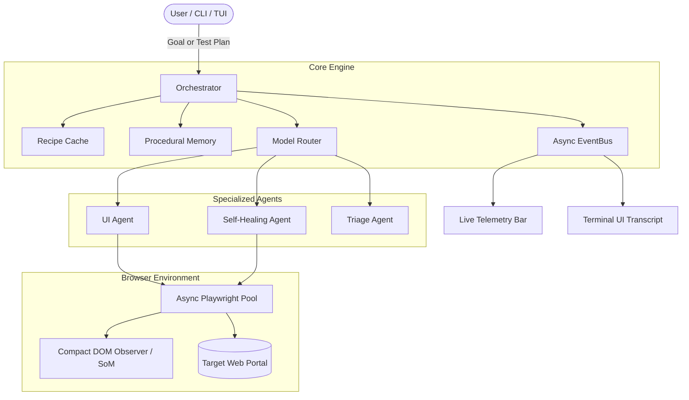

# Vettor 🧪⚡

[](https://github.com/vettor-ai/vettor/actions/workflows/ci.yml)
[](https://vettor-ai.github.io/vettor/)
[](https://www.python.org/downloads/)
[](LICENSE)
[](https://github.com/astral-sh/ruff)

> **Autonomous web QA agent harness designed for deterministic replay, zero-egress privacy, and instant self-healing.**

Inspired by `mini-swe-agent` and `omp`, Vettor couples compact local SLMs (`1.5B–4B`) with frontier LLM escalation (`Claude 3.7`, `GPT-4o`, `DeepSeek R1`) to test, triage, and self-heal complex web applications without manual selectors or flaky scripts.

---

```
  ┌────────────────────────────────────────────────────────────────────────┐
  │  VETTOR TELEMETRY │ URL: https://portal.internal │ MODEL: openai/gpt-4o│
  │  STATUS: RUNNING  │ PASS: 4 | FAIL: 0 | ERR: 0 | BUGS: 0 | CACHE: 75%  │
  ├────────────────────────────────────────────────────────────────────────┤
  │ [14:22:01] REPLAY      Step 1 -> Replayed deterministic action [vid=3] │
  │ [14:22:02] REPLAY      Step 2 -> Replayed deterministic action [vid=7] │
  │ [14:22:03] DRIFT       Step 3 -> DOM mutated! Triggering SelfHealing...│
  │ [14:22:04] HEAL        SelfHealingAgent resolved drifted target [vid=9]│
  │ [14:22:05] UIAgent     Step 4 -> Submitting form payload via click [vid=12]
  │ [14:22:06] PASS        Case #1 'Autonomous Onboarding' PASSED (3.1s)   │
  ├────────────────────────────────────────────────────────────────────────┤
  │ > /plan Verify enterprise billing checkout with multi-currency         │
  └────────────────────────────────────────────────────────────────────────┘
```

---

## ⚡ 30-Second Quickstart

Install and run Vettor with [`uv`](https://github.com/astral-sh/uv):

```bash
# Clone the repository
git clone https://github.com/vettor-ai/vettor.git
cd vettor

# Sync dependencies
uv sync

# Launch the interactive terminal UI
uv run vettor
```

Or target a web portal directly in headless CLI mode:

```bash
uv run vettor --cli --url https://example.com/checkout --goal "Verify payment validation errors on empty submission"
```

---

## 🎯 Key Features

- **Small + Frontier Routing**: Run repetitive form-filling and observation locally at 100+ tok/s using local SLMs (via `llama-server` or `Ollama`), then escalate edge-case bug triage and ambiguous UI flows to frontier models (`OpenAI`, `LiteLLM`, `OpenRouter`, or custom VPS endpoints).
- **Multi-Agent Architecture**:
  - `UIAgent`: Drives the browser via Set-of-Mark (`vid`) interactions, evaluating assertions and handling form inputs.
  - `TriageAgent`: Root-causes unexpected layout errors, network failures, and console exceptions.
  - `SelfHealingAgent`: Detects DOM structural drift and re-binds broken trajectory recipes automatically without manual test maintenance.
- **Deterministic Trajectory Recipes**: Successful runs are compiled into normalized trajectory recipes. Subsequent runs bypass LLM inference entirely (`0 ms` latency, deterministic replay) until DOM drift triggers self-healing.
- **Strict Privacy Lock**: Redacts PII, access tokens, credentials, and cookies locally before sending any prompt to cloud providers (`--private`).
- **Interactive Developer TUI**: Minimalist, high-density terminal interface built on [Textual](https://github.com/Textualize/textual) with live telemetry, streaming color-coded trajectory logs, and inline Human-In-The-Loop (`HITL`) resolution.

---

## 🏗️ Architecture



---

## 🕹️ TUI Command Reference

Vettor's interactive command bar (`>`) accepts both natural-language test instructions and slash commands:

| Command | Arguments | Description |
| :--- | :--- | :--- |
| `/run` | `[test_case.json]` | Execute a single test case or the active suite |
| `/plan` | `<goal>` | Autonomously decompose a high-level goal into atomic test steps |
| `/model` | `[provider/model_id]` | Switch active model (`llamacpp/lfm`, `openai/gpt-4o`, `ollama/...`) |
| `/workers` | `<int>` | Adjust browser pool concurrency (default: `1`) |
| `/visual` | — | Toggle Set-of-Mark (SoM) visual screenshot mode |
| `/private` | — | Toggle strict local zero-egress PII sanitization |
| `/handoff` | — | View active Human-In-The-Loop requests and hints |
| `/memory` | — | Inspect discovered DOM selectors, form mappings, and bug signatures |
| `/clear` | — | Clear current transcript logs |
| `/stop` | — | Abort currently running test execution |
| `/help` | — | Display command help and active configuration |
| `/quit` | — | Gracefully close browser sessions and exit Vettor |

---

## ⚙️ Configuration

Vettor reads configuration from `vettor.yaml`, environment variables (`VETTOR_*`), or CLI flags.

```yaml
target:
  url: "https://staging.app.example.com"
  timeout_ms: 30000

model:
  active: "openai/gpt-4o-mini"
  temperature: 0.1
  privacy_lock: true
  providers:
    openai:
      type: "openai_compat"
      base_url: "https://api.openai.com/v1"
      api_key_env: "OPENAI_API_KEY"
    llamacpp:
      type: "llamacpp_local"
      base_url: "http://127.0.0.1:8080/v1"

browser:
  headless: true
  concurrency: 2
```

---

## 📚 Documentation

Comprehensive guides, API references, and deployment architectures are available in the [Official Documentation](https://vettor-ai.github.io/vettor/):

- [Getting Started](https://vettor-ai.github.io/vettor/getting-started/)
- [Model Providers & Local SLM Setup](https://vettor-ai.github.io/vettor/providers/)
- [Multi-Agent Architecture & Self-Healing](https://vettor-ai.github.io/vettor/architecture/)
- [Terminal UI & Slash Commands](https://vettor-ai.github.io/vettor/tui/)
- [Configuration & CI/CD Recipes](https://vettor-ai.github.io/vettor/configuration/)

---

## 🛡️ License

Vettor is open-source software licensed under the [MIT License](LICENSE).
