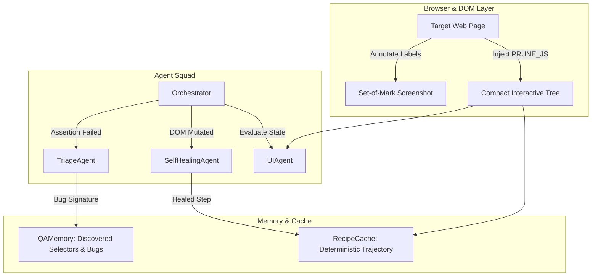

# Multi-Agent Architecture & Self-Healing 🏗️

Vettor is structured around an event-driven, multi-agent orchestration architecture that separates observation, execution, triage, and healing.



---

## 1. Compact DOM Observer & Set-of-Mark (SoM)

Modern web applications contain thousands of hidden, presentational, or styling DOM nodes. Passing raw HTML to an LLM overwhelms the context window and slows down reasoning.

Vettor's `DOMObserver` injects an optimized extraction script (`PRUNE_JS`) that:
- Filters strictly for visible, enabled interactive elements (`input`, `select`, `textarea`, `button`, `[role="button"]`, `a[href]`).
- Assigns a sequential integer **Visual Identifier (`vid`)** to each element (`[data-vettor-id="1"]`, `[data-vettor-id="2"]`...).
- Computes resilient fallback selectors (`[data-testid]`, `#id`, `tag[name]`, short `nth-of-type` paths).
- Formats observations into a compact, human- and LLM-friendly text representation:

```text
[1] input type='text' label='Username' selector='input#user-name'
[2] input type='password' label='Password' selector='input#password'
[3] button 'Login' selector='button#login-button'
```

---

## 2. Deterministic Recipe Replay

Whenever a test case completes successfully, Vettor's `RecipeCache` compiles the trajectory into a deterministic replay file (`form_recipe.json`):

- **URL Normalization**: URLs are normalized by stripping volatile tracking query parameters (`sid`, `session`, `timestamp`, `_`), retaining only structural route keys and path hashes.
- **Direct Replay**: On subsequent runs, Vettor checks if the current URL and DOM match the recipe step. If matched, the action is executed directly via Playwright without sending any prompt to the LLM.
- **Speed & Cost**: Replay steps take **0 ms LLM latency** and cost **0 tokens**.

---

## 3. Autonomous Self-Healing (`SelfHealingAgent`)

When a developer changes a class name, button text, or layout wrapper:

1. The replay engine detects that the expected selector cannot be found or has drifted.
2. An `on_drift` event is published to the `EventBus`.
3. The `SelfHealingAgent` inspects the new compact observation, finds the nearest matching semantic candidate (comparing tag, role, label, and intent), and re-binds the recipe step.
4. The test continues without manual intervention, and the cached recipe is updated automatically.

---

## 4. Root-Cause Bug Triage (`TriageAgent`)

If an assertion fails or a JavaScript error occurs:

- `TriageAgent` captures the active page URL, body text snippet, console logs, and network failure status.
- It determines the exact root cause:
  - **APPLICATION_BUG**: Uncaught TypeError, 500 API response, or validation regression.
  - **ENVIRONMENT_ERROR**: DNS failure, timeout, or backend downtime.
  - **TEST_DEFECT**: Malformed selector or outdated assertion criteria.
- The diagnosis is saved into `QAMemory` and rendered in the test summary.
